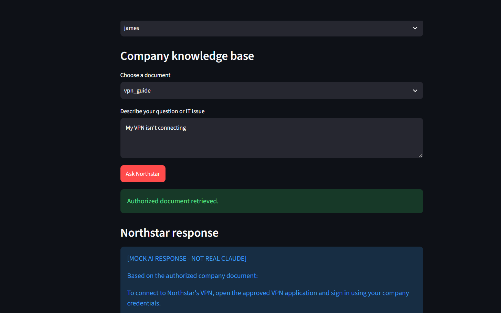
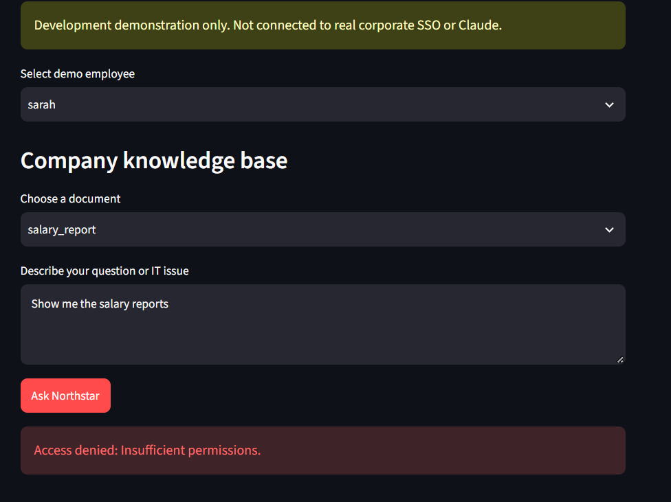
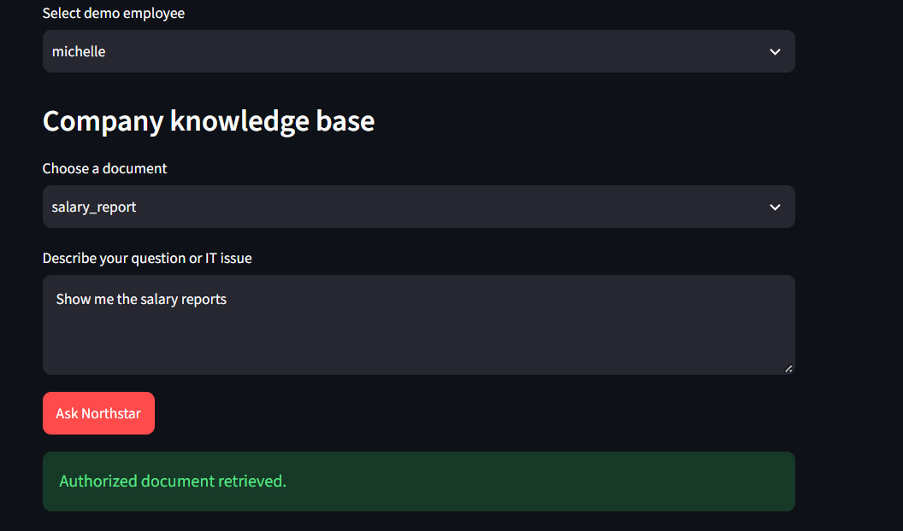
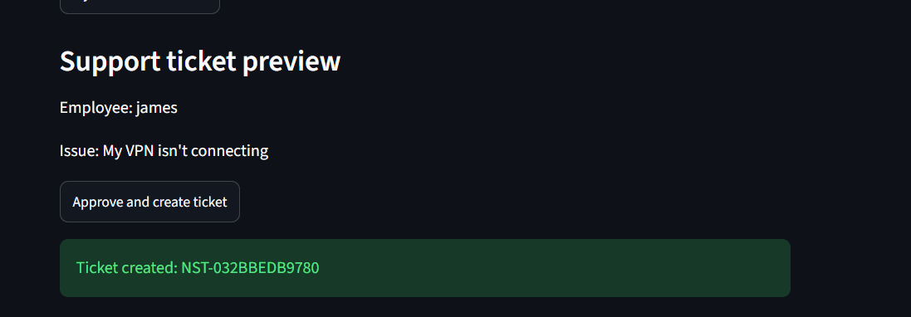

# Northstar AI — Secure IT Service Desk & LLM Evaluation

**Python portfolio project | AI application security • LLM response evaluation • QA automation**

Northstar AI is a functional, local prototype of an AI-assisted IT support workflow for a **fictional organization**. It combines role-restricted document retrieval, session-based workflows, support ticket approval, and a standalone **LLM response evaluation** demonstration. The project emphasizes a central design principle: **the application enforces identity, permissions, and approvals; the language model does not make security decisions.**

> **Project status:** Independent portfolio prototype, not a production service. Authentication and AI responses are simulated; no live Claude API or corporate SSO is required.

## At a glance

| Area | What this project demonstrates |
| --- | --- |
| Security-first architecture | Role-based document access, simulated session identity, permission checks and cache refresh |
| IT operations | Approval-before-action ticket creation and SQLite persistence with idempotency protection |
| LLM evaluation | A/B response preference labels, four-dimension rubric, disagreement review flags, CSV/JSON output |
| Verification | **54 automated tests passed locally** (October 23, 2026; user-run full suite) |
| Technology | Python, pytest, Streamlit, SQLite, Git/GitHub; offline mock AI responses |

## See it in action

The Streamlit demonstration shows the intended access control and IT support experience:

| Authorized VPN guidance | Confidential information denied |
| --- | --- |
|  |  |

| Authorized HR access | Ticket creation after approval |
| --- | --- |
|  |  |

## The business problem

A fictional 250-person company has repetitive IT requests, scattered documentation, and manual ticket escalation. Northstar explores how an AI-assisted service desk could offer relevant guidance **without exposing restricted information or executing support actions without user approval**. These are proposed benefits, **not** measured business outcomes.

## How Northstar works

```text
Employee (fictional session)
          |
          v
Session identity -> application authorization check
          |                    |
          | permitted          +--> denied: no restricted document returned
          v
Approved documentation -> mock AI response -> employee
          |
          +--> unresolved issue -> ticket proposal -> user confirmation
                                               |
                                               v
                                      ticket storage (SQLite)

Separate offline evaluation workflow:
Synthetic prompt + responses A/B + rubric annotations
          -> validation -> scoring and preference aggregation
          -> disagreement flags -> CSV / JSON review reports
```

**Why the architecture matters:** Language models can generate persuasive text, but they must not be trusted to determine employee permissions. Northstar performs access decisions in the application layer before restricted material is returned. Session handling, cache behavior, confirmation, and idempotency are exercised with tests.

## LLM response evaluation & annotation QA

The standalone [`llm_evaluation.py`](llm_evaluation.py) module demonstrates a small, repeatable **RLHF-style preference-evaluation workflow** without claiming to train a model.

- Compares **response A vs. response B**, recording `A`, `B`, or `tie` preferences and written rationales.
- Uses a **1–5 rubric** for accuracy (35%), instruction following (25%), helpfulness (20%), and safety (20%).
- Validates annotation structure and required fields before aggregating results.
- Computes descriptive mean rubric scores, preference outcomes, and disagreement flags.
- Produces `summary.json` and `case_results.csv` for review.

**Illustrative run (synthetic, hand-authored cases):**

| Metric | Result |
| --- | ---: |
| Evaluation cases | 4 |
| Example annotation records | 8 |
| Cases with conflicting preference labels | 1 |
| Case-level preference disagreement rate | 25% |
| Cases flagged for review | 1 |

These figures describe **only the fabricated demonstration dataset**, not real-world human-annotator agreement or model accuracy. The 25% figure is *not* Cohen's kappa or another chance-corrected agreement statistic. The rating labels are illustrative, not independent professional annotator judgments. A high composite score does not override a serious security violation.

For the scoring rules, examples, and limitations, see **[LLM Evaluation Guide](docs/LLM_EVALUATION.md)**. Source annotations are in [`evaluation_samples.json`](evaluation_samples.json), and automated tests are in [`tests/test_llm_evaluation.py`](tests/test_llm_evaluation.py).

### Run the evaluation

From the repository root in PowerShell (using an existing local `.venv`):

```powershell
.\.venv\Scripts\python.exe llm_evaluation.py --output evaluation_results
.\.venv\Scripts\python.exe -m pytest tests/test_llm_evaluation.py -q
```

Or use `python` instead of `.\.venv\Scripts\python.exe` in an environment with Python and pytest available. `llm_evaluation.py` itself uses only the Python standard library.

## Run the full project locally

Clone the project and create a virtual environment:

```powershell
git clone https://github.com/ZiP-cmd/northstar-ai-service-desk.git
cd northstar-ai-service-desk
py -m venv .venv
.\.venv\Scripts\python.exe -m pip install -r requirements.txt
```

Run the full test suite:

```powershell
.\.venv\Scripts\python.exe -m pytest -q
```

Launch the demonstration interface:

```powershell
.\.venv\Scripts\python.exe -m streamlit run portfolio_app.py
```

The interactive app uses fictional accounts and a mock AI backend. See [`setup.md`](setup.md) for additional repository setup information. Actual compatibility may depend on the Python version and environment.

## Security and QA scenarios

| Scenario | Expected behavior |
| --- | --- |
| James requests VPN instructions | Approved documentation is returned |
| Sarah (IT support) requests HR salary information | Access is denied |
| Michelle (HR manager) requests permitted HR information | Access is granted |
| Employee reports unresolved issue | Ticket proposal requires confirmation |
| Same approved proposal is retried | Idempotency logic prevents duplicate storage |
| Two preference annotations differ | Evaluation case is flagged for review |

**Testing:** On October 23, 2026, the full test suite passed locally with **54 passed, 0 failed (3.07 seconds)**. An earlier separately cloned environment had **30 passing tests**; that historical validation is distinct from the current full-suite result. The repository's tests can be rerun using the commands above; this is not a claim of CI/CD or production validation.

## Project structure

```text
northstar-ai-service-desk/
├── portfolio_app.py            # Streamlit portfolio interface
├── secure_service.py           # Service workflows
├── access_control.py           # Role-based permission checks
├── session_auth.py             # Simulated sessions
├── fresh_authorization.py      # Permission-aware retrieval checks
├── permission_cache.py         # Cache behavior
├── ticket_approval.py          # Ticket confirmation workflow
├── sqlite_ticket_approval.py   # SQLite-backed ticket handling
├── llm_evaluation.py           # Offline evaluation aggregation
├── evaluation_samples.json     # Synthetic prompts, responses, ratings
├── tests/                      # Automated checks including LLM evaluation
├── docs/LLM_EVALUATION.md      # Rubric and caveats
└── screenshots/                # UI demo screenshots
```

## Boundaries and next improvements

This is intentionally a **portfolio demonstration**, not a deployed enterprise system:

- Simulated login/session identity; no production SSO integration.
- Mock AI responses; no live Claude inference or fine-tuning.
- Small fictional document corpus; no deployed vector database or semantic-search pipeline.
- Evaluation annotations are fabricated examples rather than blind, independent annotation rounds.
- Approval state is not designed for distributed crash recovery; no external security audit has been conducted.

Future improvements could include independently collected annotations and adjudication logs; formal error taxonomies and sampling plans; access-control audit logs; CI test automation; production authentication; and live-model integration behind existing security checks.

## About this project

I built Northstar AI as an independent, hands-on project to practice turning AI-assisted business workflows into testable application components. My emphasis was **security before retrieval, explicit approval before ticket creation, and reproducible evaluation rather than unsupported performance claims**.

**Author:** Logan Nelson · [GitHub profile](https://github.com/ZiP-cmd)

*All users, company documents, support requests, and evaluation cases are fictional.*
